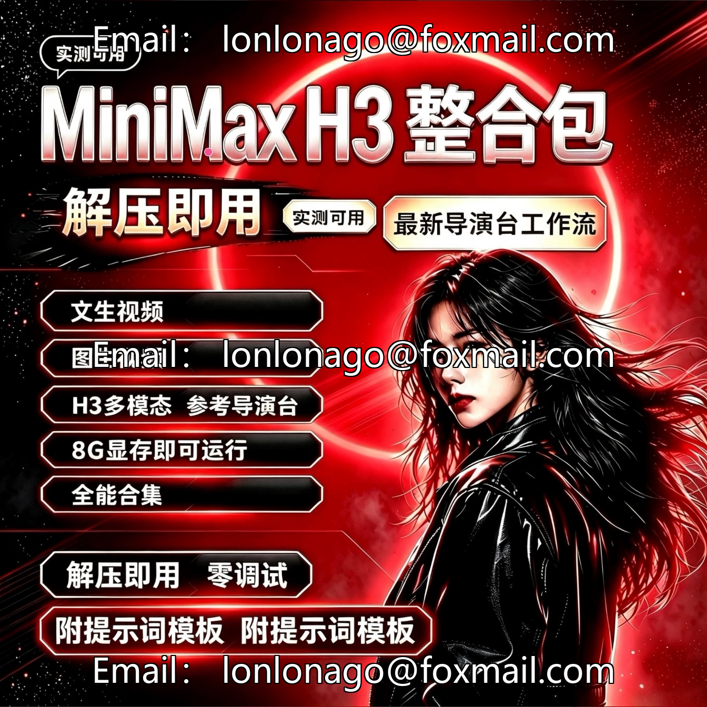
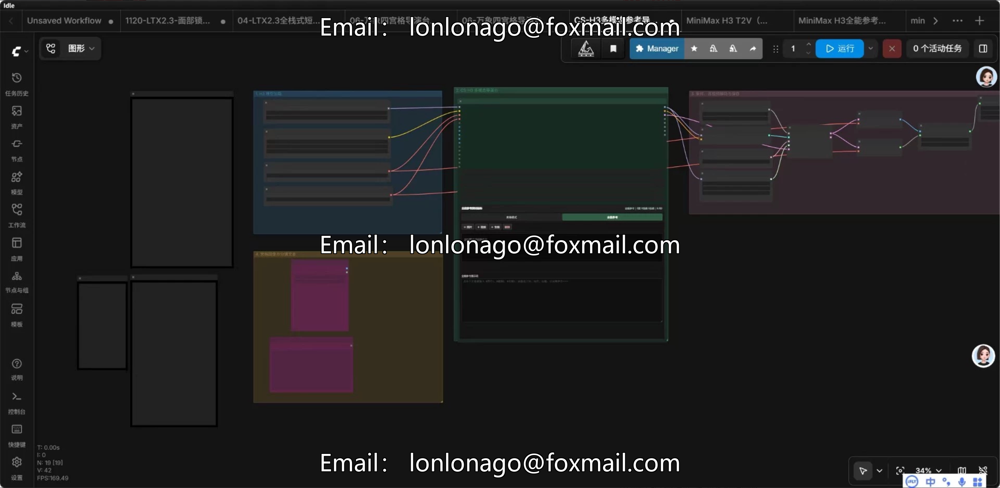
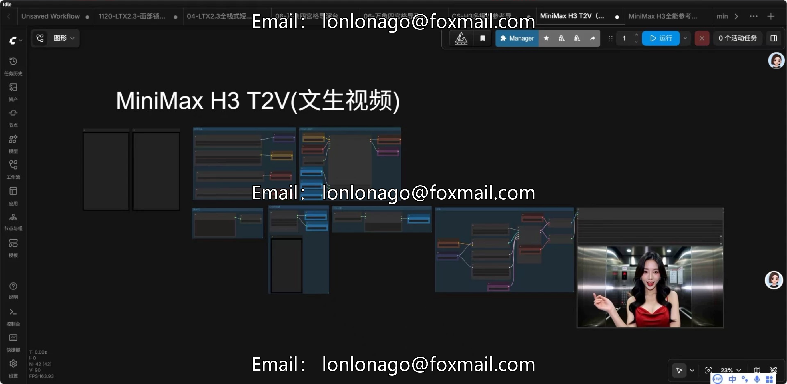
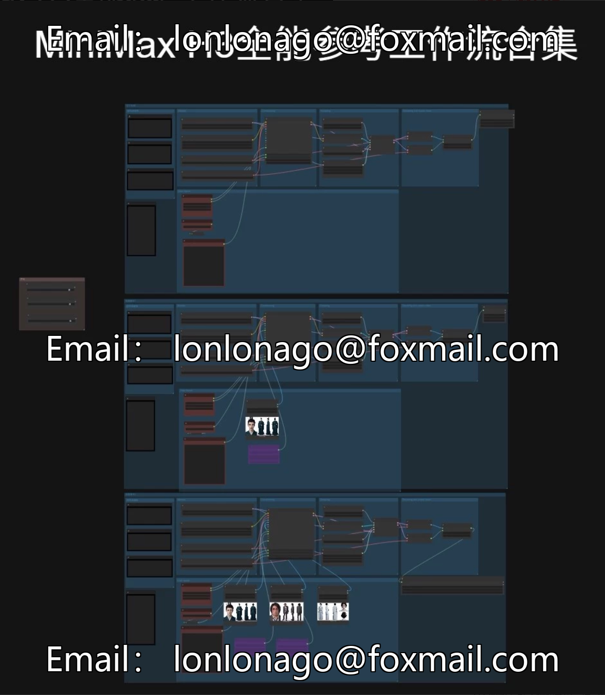

# MiniMax H3 Reference Director's Desk Complete Edition Integrated Pack, internally also includes LTX.

## Body

MiniMax H3 Reference Director's Desk Complete Edition package, internally also includes LTX2.3 integration content.
Integrated with a complete ComfyUI environment, this product is primarily designed for controlled AI video creation. It can be operated with just 8GB of GPU memory and does not require the setup of workflows or the tuning of parameters; simply decompressing it will enable you to access professional-level director's console features.

Core Features
Wensheng Video: Directly generate high-definition dynamic videos from text descriptions.
Video Tutorial: Convert static images into continuous dynamic scenes with one click.
H3 Multimodal Reference Director: Supports reference image anchoring of characters, scenes, and styles, with precise control over the visuals, significantly improving video coherence.
All-in-One Collection: All supporting features packaged together, covering various AI video creation needs in daily life.

Configuration Threshold
Minimum 8GB of video memory is required for operation, and N-series or higher models can be fitted.
Built-in video memory optimization scheme ensures stable use of director's console even on low-configuration devices.
Ready to use upon arrival, no hassle required.
Unpack and run directly: ComfyUI environment + all dependencies pre-installed, no complex setup required.

Zero Debugging Hands-On: Director's Console Workflow Optimized with Integrated Parameters, Importing directly calls for quick film production by beginners.
Attachment prompt word template: A curated prompt word library for easy use, significantly enhancing the efficiency of film production.
Full-process real-time testing: All features are tested and verified to be functional, avoiding pitfalls with ineffective resources.

## Images

## Payment

Here is a pay link on Stripe ( https://buy.stripe.com/3cs8yP7sY87d0vu9AB ). Please contact me lonlonago@foxmail.com after funding $89, and I will send you a complete data files , thank you!

